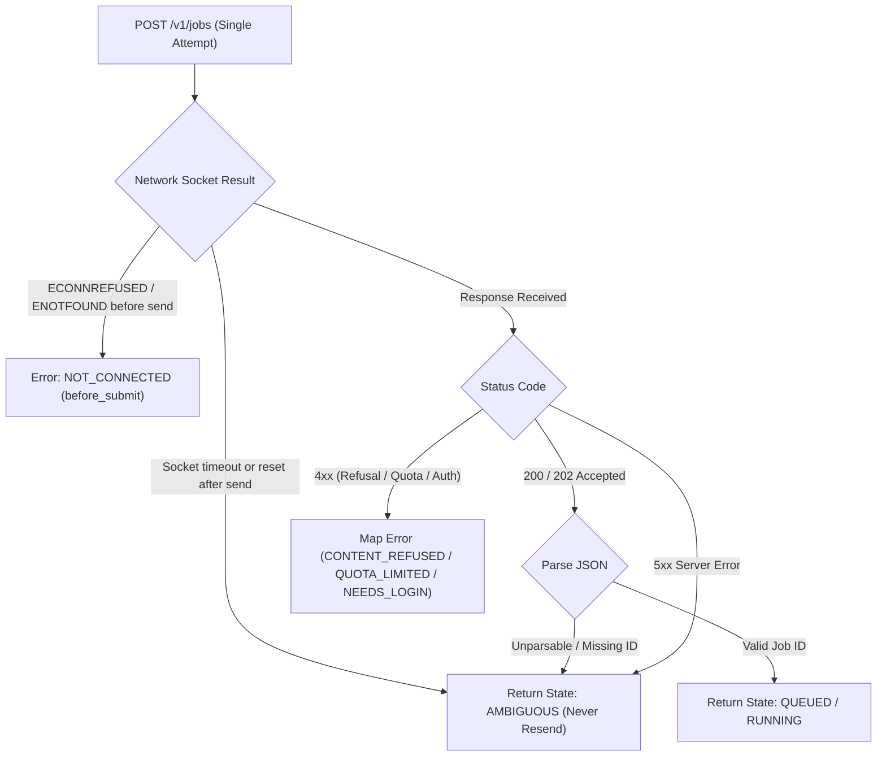

# Muse Provider Integration Contract (Local REST Bridge)

_Specification date: 2026-11-23. Implemented in `src/main/providers/muse`._

## 1. Overview and Boundary

Per **ADR-001** and Brief §3.3, all Muse-specific knowledge is strictly isolated behind the `MuseProvider` interface (`src/shared/provider.ts`). The application UI and orchestrator communicate exclusively with this interface and have no awareness of network endpoints, HTTP status codes, or bridge payloads.

There are two implementations:
- `MockMuseProvider`: offline, deterministic, multi-scenario mock for testing and offline development.
- `RestBridgeMuseProvider`: loopback-only (`127.0.0.1`, `localhost`, `[::1]`) typed HTTP REST client for the company's approved local bridge.

> [!IMPORTANT]
> This contract documents the approved local bridge REST façade. It is **not** an official public API provided by Muse. Real provider endpoints and selectors must never be called directly.

---

## 2. Security and Network Policy

1. **Loopback-Only Constraint**: Base URL must resolve strictly to `127.0.0.1`, `localhost`, or `[::1]`. Any remote IP, LAN address, or public domain is rejected before any network request is created.
2. **No Port Scanning**: The port must be explicitly configured (or discovered through approved mechanism); port scanning is strictly prohibited.
3. **No Redirects**: All HTTP requests use `redirect: 'manual'`. Any 3xx redirect status is treated as a security violation and rejected.
4. **Secret Storage and Logging**:
   - Authentication uses `Authorization: Bearer <API_KEY>`.
   - The API key is read on-demand per request via `deps.getApiKey()` and is never cached in persistent state.
   - Logs record **only** event names, job IDs, request IDs, HTTP status codes, and durations.
   - **Never logged**: prompt text, raw image bytes, API keys, cookies, session IDs, or signed query strings.

---

## 3. Bridge Endpoints and Request/Response Shapes

### 3.1 Health Check (Unauthenticated)
- **Method**: `GET /v1/health`
- **Auth**: None
- **Response**:
  ```json
  {
    "status": "ok",
    "healthy": true
  }
  ```
- **Error Semantics**: Connection refused or socket error maps to `not_installed`.

### 3.2 Status & Capabilities (Authenticated)
- **Method**: `GET /v1/status`
- **Headers**: `Authorization: Bearer <API_KEY>`
- **Response (example)**:
  ```json
  {
    "status": "ready",
    "authenticated": true,
    "needs_login": false,
    "quota_limited": false,
    "capabilities": {
      "can_cancel": true,
      "reports_progress": true,
      "supported_durations": [5, 10],
      "supported_aspect_ratios": ["9:16", "16:9", "1:1"],
      "max_prompt_chars": 4000,
      "max_upload_bytes": 20971520,
      "can_lookup_by_request_id": true
    }
  }
  ```
- **Mapping**:
  - `status === 'needs_login'` or `needs_login: true` → `ProviderConnectionState: 'needs_login'`
  - `status === 'quota_limited'` or `quota_limited: true` → `ProviderConnectionState: 'quota_limited'`
  - HTTP 401/403 → `ProviderConnectionState: 'error'` (safe message; key omitted)

### 3.3 Reference Image Upload
- **Method**: `POST /v1/references`
- **Headers**:
  - `Authorization: Bearer <API_KEY>`
  - `Content-Type: image/png` (or `image/jpeg`, `image/webp`)
  - `X-File-Name: <sanitized-base-filename>`
- **Body**: Raw binary image bytes (capped at `maxUploadBytes`, default 20 MiB).
- **Response**:
  ```json
  {
    "reference_id": "ref-9f8e7d6c",
    "kind": "image",
    "mime": "image/png",
    "bytes": 2048576,
    "sha256": "e3b0c44298fc1c149afbf4c8996fb92427ae41e4649b934ca495991b7852b855"
  }
  ```
- **Phase**: All failures during reference upload are `before_submit` because no video generation was requested yet.

### 3.4 Video Job Submission
- **Method**: `POST /v1/jobs`
- **Headers**:
  - `Authorization: Bearer <API_KEY>`
  - `Content-Type: application/json`
  - `Idempotency-Key: <internal-job-requestId-UUID>`
- **Body**:
  ```json
  {
    "kind": "video",
    "mode": "reference",
    "prompt": "Authentic product review scene showing TS-001...",
    "reference_id": "ref-9f8e7d6c",
    "repeat": 1,
    "account": "auto",
    "duration": 5,
    "aspect_ratio": "9:16"
  }
  ```
- **Response**: `HTTP 202 Accepted`
  ```json
  {
    "id": "job-837482",
    "state": "queued"
  }
  ```

---

## 4. Idempotency and Ambiguous-Submit Semantics

A critical guarantee (Brief §0.6, §4.3, §4.5) is preventing duplicate generation jobs and wasted quota.



### Outcomes:
1. **Network error before send (`ECONNREFUSED`, `ENOTFOUND`)**:
   - Phase: `before_submit`.
   - Error code: `NOT_CONNECTED`.
   - Retryable manually by user because the bridge never saw the request.
2. **Confirmed Acceptance (`200 / 202`)**:
   - Job ID is extracted and stored.
   - State: `queued` or `running`.
3. **5xx Server Error, Timeout, Socket Reset after send, or unparsable 2xx**:
   - State: `ambiguous`.
   - Error code: `SUBMIT_AMBIGUOUS`.
   - **Rule**: Never automatically resubmit. The request may already have been accepted and queued by the bridge. User must inspect or reconcile before any re-attempt.

---

## 5. Job Status and Asset Download

### 5.1 Query Job
- **Method**: `GET /v1/jobs/{id}`
- **Headers**: `Authorization: Bearer <API_KEY>`
- **Response**:
  ```json
  {
    "id": "job-837482",
    "state": "succeeded",
    "progress": 1.0,
    "asset_id": "asset-54321",
    "asset_url": "http://127.0.0.1:47821/v1/assets/asset-54321/download"
  }
  ```
- **Progress**: Reported only if genuinely numerical (0.0 to 1.0). Never fabricated.

### 5.2 Asset Download
- **Method**: `GET /v1/assets/{id}/download`
- **Origin Validation**: The download URL origin must strictly equal the bridge base URL origin. Foreign origins are rejected.
- **Streaming & Size Cap**:
  - Streamed directly to destination `.part` temp file.
  - Aborted immediately if bytes exceed `maxBytes`.
  - On error or size excess: `.part` file is deleted immediately.

---

## 6. Error Mapping Table

### 6.1 `POST /v1/jobs` Explicit Mapping Table

| Trigger | Provider Error Code | Failure Phase | Action / State |
|---|---|---|---|
| Body code: `content_refused`, `refused`, `safety` | `CONTENT_REFUSED` | `after_submit` | Terminal refusal; do not alter artwork |
| Body code: `quota`, `credits`, `rate_limited` | `QUOTA_LIMITED` | `before_submit`* | Stop; show quota message |
| Body code: `needs_login`, `login_required`, `unauthenticated` | `NEEDS_LOGIN` | `before_submit` | Prompt user to sign in through provider UI |
| HTTP 401, 403 (no matching body code) | `NEEDS_LOGIN` | `before_submit` | Auth layer rejected before processing |
| HTTP 400, 413, 415, 422 (validation errors) | `PROVIDER_ERROR` | `before_submit` | Client validation failure |
| HTTP 429 (no body code) | `QUOTA_LIMITED` | `before_submit`* | Generation stopped |
| HTTP 408, 409, or any other 4xx | `SUBMIT_AMBIGUOUS` | `after_submit` | Return ambiguous job; **never resubmit** |
| HTTP 5xx, timeout, socket reset after send | `SUBMIT_AMBIGUOUS` | `after_submit` | Return ambiguous job; **never resubmit** |

_\* Phase is `after_submit` only when the bridge response explicitly asserts `submitted: true`._

### 6.2 Connection, Query, and Download Error Mapping

| Condition | Provider Error Code | Failure Phase | Safe Message |
|---|---|---|---|
| Unreachable `/v1/health` | `NOT_CONNECTED` | `before_submit` | The Muse bridge is not running or cannot be reached. |
| Non-loopback base URL | `UNSUPPORTED_PLATFORM` | `before_submit` | Non-loopback bridge URLs are strictly forbidden. |
| Missing API Key (`getConnectionState`) | `error` | N/A | Provider state is error; hasApiKey shown separately in UI. |
| Missing API Key (`generateVideo` / `getJob`) | `NEEDS_LOGIN` | `before_submit` | Please sign in to Muse through the normal Muse login. |
| `getJob` / `cancelJob` connection refused | `NOT_CONNECTED` | `after_submit` | Bridge connection was refused. |
| `getJob` timeout / malformed JSON | `PROVIDER_ERROR` | `after_submit` | Failed to query job from bridge. |
| Missing MP4 asset | `OUTPUT_MISSING` | `after_submit` | Muse marked the job complete but no video was delivered. |
| Pre-download `getJob` query failure | `DOWNLOAD_FAILED` | `after_submit` | Failed to retrieve job status before download. |
| Stream truncated / oversized / redirect | `DOWNLOAD_FAILED` | `after_submit` | The video was generated but could not be downloaded. |

---

## 7. Items to Verify Against Live `/v1/openapi.json`

Before deploying against a live bridge in production:
1. Verify exact endpoint paths: `/v1/health`, `/v1/status`, `/v1/references`, `/v1/jobs`.
2. Verify field names for reference ID: `reference_id` vs `id`.
3. Verify field names in job submit payload: `kind`, `mode`, `reference_id`, `repeat`, `account`.
4. Verify response field names for job submission: `id` vs `job_id` vs `jobs[0].id`.
5. Verify job status enum strings: `queued`, `running`, `succeeded`, `failed`, `cancelled`.
6. Verify whether the bridge supports `GET /v1/jobs?idempotency_key=` for ambiguous job reconciliation.
