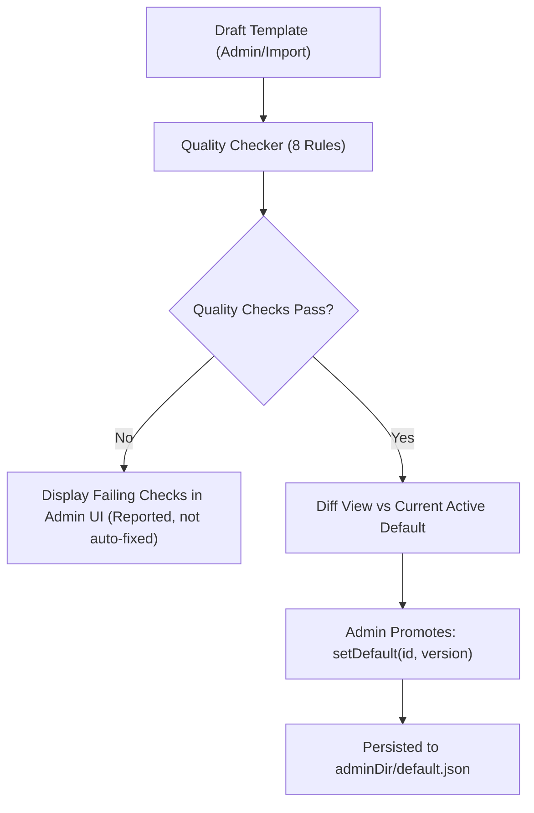

# Prompt Master Versioning & Lifecycle Management

## 1. Important Notice: Shipped Templates are Placeholders

> [!WARNING]
> **The built-in prompt templates shipped with POD Video Studio (`prompts/master/product-review-v1.md` and `prompts/master/product-review-v2.md`) are PLACEHOLDERS.**
> They provide a working structure for developer testing and early verification, but they do NOT contain the company's approved Prompt Master text. Production video generation requires importing or configuring the company-approved Prompt Master via `PROMPT_MASTER_PATH` or the Admin template manager.

---

## 2. Architecture & Template Sources

POD Video Studio loads prompt templates from three distinct sources, categorized by their provenance:

```
┌─────────────────────────────────────────────────────────────┐
│                       Template Sources                       │
├───────────────────┬─────────────────────┬───────────────────┤
│     'builtin'     │      'company'      │      'admin'      │
│  prompts/master/  │ PROMPT_MASTER_PATH  │  <adminDir>/<id>/ │
│   (Placeholder)   │ (Company Canonical) │ (Admin Revisions) │
└───────────────────┴─────────────────────┴───────────────────┘
```

1. **`builtin`**:
   - Location: `prompts/master/*.md` (e.g. `product-review-v1.md`, `product-review-v2.md`).
   - Flag: `isPlaceholder: true`.
   - Purpose: Shipped with the application bundle to guarantee the system can function in offline or staging environments without external setup.

2. **`company`**:
   - Location: Configured path in `PROMPT_MASTER_PATH` (or config file).
   - Flag: `isPlaceholder: false`.
   - Versioning: Extracted from frontmatter `version: ...` or derived as `company-<sha256 first 8>` if no version header is present.
   - Behavior: When present and readable, it automatically overrides the built-in placeholder and becomes the active default. If the file is missing or unreadable, the application logs a non-fatal warning and safely falls back to the built-in placeholder without crashing.

3. **`admin`**:
   - Location: Private application data directory: `<adminDir>/<id>/<version>.md` (e.g. `userData/prompts/admin/product-review/v3.md`).
   - Flag: `isPlaceholder: false`.
   - Behavior: Saved through the Admin interface.

---

## 3. Template Structure & Frontmatter Schema

Each template is stored as a Markdown file with a YAML-like frontmatter header delimited by `---`:

```markdown
---
id: product-review
version: v2
title: Product review (PLACEHOLDER)
placeholder: true
created_at: 2026-11-23
note: Replace with the company-approved Prompt Master V2 text.
default: true
---
[PLACEHOLDER PROMPT MASTER — replace with the company-approved text via PROMPT_MASTER_PATH or Admin]

Create a realistic human product review video showcasing the product.
Product SKU: {{sku}}
Category: {{product_category}}
Product Name: {{product_name}}
Review Style: {{review_style}}
Duration: {{duration_seconds}} seconds
Aspect Ratio: {{aspect_ratio}}
...
{{category_rules}}
```

### Allowed Template Variables

Templates support strictly validated variables. Unknown variable names (`{{foo}}`) or unclosed braces (`{{bar`) immediately trigger validation errors:

- `{{sku}}`: Product SKU (required).
- `{{product_category}}`: Category name (required).
- `{{product_name}}`: Optional product title. If omitted by the user, the entire line containing `{{product_name}}` is pruned.
- `{{review_style}}`: Optional tone/style directive. If omitted, the entire line is pruned.
- `{{duration_seconds}}`: Video duration. Pruned if missing or if provider has `supportsDuration: false`.
- `{{aspect_ratio}}`: Frame ratio (e.g., `16:9`, `9:16`). Pruned if missing or if provider has `supportsAspectRatio: false`.
- `{{source_image_filename}}`: File name metadata only. Directory paths are stripped to prevent path leakage.
- `{{category_rules}}`: Internal injection slot for group-specific handling notes (`prompts/categories/*.md`).

### Value Sanitization & Injection Defense

To prevent template injection:
1. Control characters are stripped.
2. Newlines in single-line variables are collapsed into single spaces.
3. Any `{{` or `}}` characters within user-supplied values are neutralized to `{ {` and `} }`.
4. Template rendering is strictly single-pass (no recursive evaluation).

---

## 4. Immutability & Version Creation

All template files are strictly immutable:

1. **No Overwrites**: The service saves new versions using the filesystem `wx` flag (`O_CREAT | O_EXCL`). If a file already exists at the target path, the write fails immediately.
2. **Monotonic Version Numbering**: When an admin saves a new version (`saveTemplateVersion`), the service inspects all existing versions of that template ID (e.g., `v1`, `v2`), finds the maximum integer $N$, and writes the new file as `v<N+1>.md` (e.g., `v3.md`).
3. **Audit Trail**: Every admin-saved template records the creation date, author notes, and version title in its frontmatter.

---

## 5. Review & Quality Validation Workflow

Before a new template version can be promoted to default, it must undergo automated quality verification:



### Quality Rules Checked

1. **`preserve_artwork`**: The prompt must explicitly require preserving the exact uploaded artwork, print, and typography.
2. **`no_design_changes`**: Prohibits altering, recoloring, distorting, mirroring, or redesigning the artwork.
3. **`consistent_product`**: Requires maintaining garment/product construction and appearance consistency.
4. **`natural_texture`**: Mandates natural textures for materials, hands, and skin, prohibiting a plastic look.
5. **`physical_continuity`**: Mandates physically continuous movement, realistic gravity, folds, and object permanence.
6. **`no_impossible_transitions`**: Forbids impossible morphing, sudden disappearance, teleporting, or hands passing through objects.
7. **`human_review_action`**: Enforces an authentic human reviewer interaction demonstrating the product, rejecting mere static pans or slow zooms.
8. **`no_fake_claims`**: Prohibits unauthorized discounts, fake ratings, badges, or fabricated claims.

---

## 6. Setting Default & Safe Instant Rollback

### Default Selection Storage

The active default template version is recorded in `<adminDir>/default.json`:

```json
{
  "product-review": "v3"
}
```

When the service boots:
1. If `<adminDir>/default.json` specifies a version for `product-review` and that version exists, it is marked as `isDefault = true`.
2. Otherwise, if a company master was successfully loaded, the company template is default.
3. Otherwise, built-in template `v2` is default.

### Rolling Back

Because previous version files (`v1.md`, `v2.md`, etc.) are immutable and permanently preserved on disk:
- Rolling back requires only a call to `setDefault(id, previousVersion)` (e.g., `setDefault('product-review', 'v2')`).
- The operation immediately updates `<adminDir>/default.json`.
- The rollback takes effect across the entire application with zero downtime and without modifying or deleting any template files.
